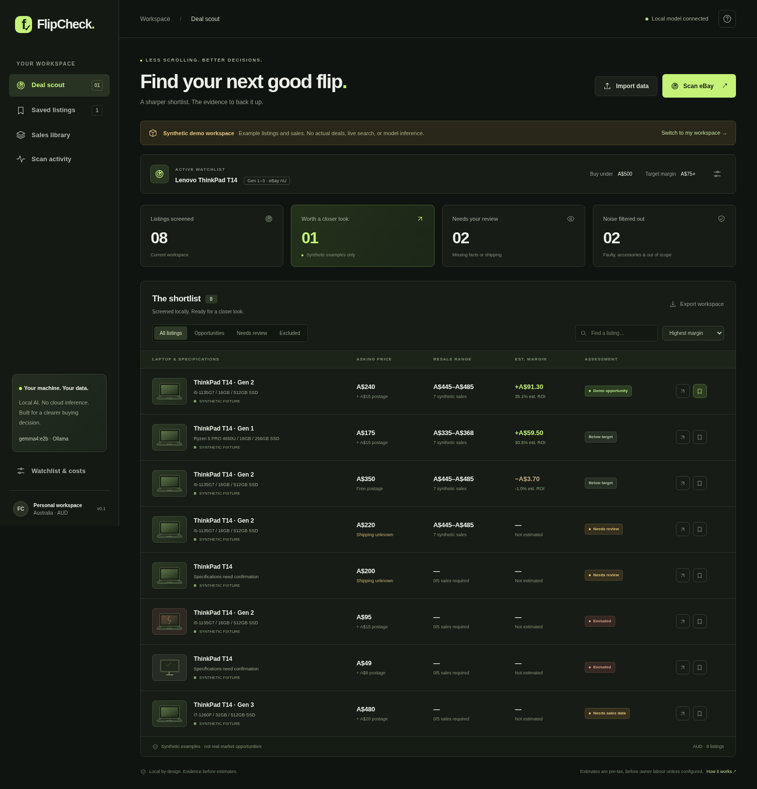

# FlipCheck

**Find your next good flip. Keep the evidence.**

A local deal scout for Australian used-tech resellers, powered by Gemma 4 through Ollama. Track Legion laptops, MacBooks, cameras, and other supported products in one workspace, with independent budgets and costs for each search. Listings come from live eBay Australia searches or your own real imports.



## Run locally

Node.js **20.9+** and Python **3.11+** are required. Next.js/TypeScript lives in `frontend/`; the Python/SQLite API lives in `flipcheck/`. No extra Python packages or database service are needed.

```sh
npm ci
npm run dev
```

Open **http://127.0.0.1:3030**. The launcher starts Next.js and the API on port 8765, or reuses an existing healthy API. Install [Ollama](https://ollama.com/) separately and download your local model:

```sh
ollama pull gemma4:e2b
```

Copy `.env.example` to `.env` once, preserving any existing private configuration, then set:

```dotenv
OLLAMA_URL=http://127.0.0.1:11434
OLLAMA_MODEL=gemma4:e2b
SERPAPI_KEY=your_private_key
```

Restart after configuration changes. The app never substitutes a hosted model. Shell variables take precedence. `.env`, databases and private reports are Git-ignored; private keys must never use `NEXT_PUBLIC_*` variables.

## Search several products together

1. Click **Add search**. Set the query, category, budget, target margin, and costs.
2. Add separate searches for the products you want, such as Legion, MacBook, and camera. Each keeps its own assumptions.
3. Click **Scan all (N)** to run every enabled search in one job, or **Scan this search** on one search card.
4. Use **Filter by search** to inspect one product's results. Shared listings appear once, with matching search labels. The evidence drawer lets you choose which search's costs to inspect.
5. Pause, edit, or archive searches as needed. Archiving preserves the listings, decisions and history. Unassigned listings cannot receive a default-cost valuation.

Up to ten searches can be saved. Live runs request each selected source sequentially and admit at most ten listings per product search (100 total before deduplication): ten for a single source, or five each when eBay and Facebook are both selected. eBay allows at most one transient retry; paid Facebook run creation is never automatically retried. Duplicate marketplace IDs are analysed once and linked to all matching searches. Partial failures retain successful results and show per-search outcomes and request counts.

Search requires SerpApi quota and internet. Queries leave your laptop; extraction, corrections and storage remain local by default. No automatic purchases or seller messages occur. Facebook Marketplace uses the separate location-based connector described below.

Cards and the evidence view display the original listing photos when returned by eBay/Facebook, with a selectable gallery for multiple photos. Images are linked from the marketplace CDN with no referrer; they are not generated or replaced with catalogue photos. Missing/expired images show a clear unavailable state. Existing listings pick up image URLs on their next scan; image-only updates preserve extraction, decisions and price history.

There is **no runtime demo, seeded listing feed, or fictional fallback**. An empty workspace stays empty until a real scan or import succeeds. Downloadable import templates contain empty arrays. Test fixtures are used only by development tools.

## Facebook Marketplace near your position

Your private `.env` also needs `APIFY_TOKEN` for Facebook. This uses the third-party [memo23 Marketplace connector](https://apify.com/memo23/facebook-marketplace-scraper-ppe) on Apify; it is separate from SerpApi and requires available provider credit. No Facebook cookies or passwords are requested.

Edit or add a product search:

1. Select **Facebook Marketplace**, optionally keeping **eBay Australia** selected too.
2. Click **Use my location** and grant the browser permission, or enter an Australian suburb/postcode and click **Find location**, then choose a result.
3. Set **Pickup radius (km)** and optionally your **Pickup / travel allowance (AUD)**. Leaving cost unknown prevents margin calculations; zero is an explicit free-collection assumption.
4. Save and **Scan all** or scan that search alone. Existing eBay searches retain their original source until you change them.

No position is read automatically. Coordinates are rounded to three decimals before storage/provider requests. Place lookup uses [Nominatim](https://nominatim.org/release-docs/latest/api/Search/) with an AU restriction and a deliberate search button; no autocomplete. Queries go to Nominatim, and Facebook searches send product terms and rounded coordinates to Apify/Facebook. Local imports and Gemma inference remain local.

The adapter starts one capped actor run per selected Facebook search: 120-second actor timeout, USD 0.25 maximum charge, and an explicit result cap. It polls status, aborts a known unfinished run on errors/timeouts when possible, and never automatically starts a replacement paid run. Provider requests include polling/dataset reads, so request counts are not the number of billed listing events. Actual charges follow the provider's terms.

Only active, non-sold, non-pending local-pickup listings with an explicit AUD price and published coordinates inside the selected radius are admitted. Radius filtering is calculated locally too, because upstream filters may overreach. Distance is approximate and straight-line, based on the published map pin; confirm the pickup address. Missing coordinates/currency and unsupported variants are skipped, not guessed. Failed/blocked/empty Facebook searches retain successful eBay results and never trigger fictional or Google-indexed fallback results.

Listings from different marketplaces have independent identities. Shared Facebook listings keep per-search distances and pickup costs. Changing a center/radius recalculates their distance and disables valuations for historical results outside the new area. Unknown pickup cost remains a review state. No genuine completed-sale prices are inferred from Marketplace asking prices.

## Product evidence and valuation

Supported profiles: laptops, cameras, phones, tablets, consoles, and GPUs. Other products can be discovered but remain review-only. Supported category does not mean every listing will be complete enough to price.

- Laptops require the stated manufacturer/model, CPU, RAM, storage and condition; gaming models also require a GPU.
- Camera valuation distinguishes explicit body-only units from kits with an identified lens. Unspecified bundles require review.
- Phones/tablets require storage and lock/network status. Consoles require edition, storage and a supported inclusion description; unspecified bundles require review. GPUs require VRAM.
- Unknown, contradictory or unsupported facts remain review-only. Faulty products and accessories are excluded. Numeric evidence must include relevant capacity units and context.

Comparison-based valuation requires **at least five** recent genuine completed sales with an exact matching product configuration and seller-stated condition. Provided material attributes participate in matching, so a known lens/GPU does not match an unknown one. A sparse sample produces no supported range. Five is a guardrail, not statistical certainty; quartiles describe the supplied sample.

No genuine sold-price dataset is bundled. Import your own traceable sales with actual transaction prices; verification is asserted by you, not independently audited by FlipCheck. An optional explicit resale assumption is labelled as yours and cannot earn an evidence-backed opportunity badge. Missing inbound shipping prevents margin calculations. Default costs are illustrative, not current marketplace fees. Estimates are AUD and pre-tax; labour is included only as configured.

The search adapter requests AU domestic fixed-price results, excludes ambiguous prices and variations, and discloses reliance on the domestic filter when item location is missing. Availability and physical condition still need checking on the original listing. See [import formats](docs/data-formats.md).

## Existing workspaces

The migration runs once. Your saved single query becomes a search with the same budget/costs, and existing real eBay listings keep their records and decisions. Old synthetic records are hidden from runtime state and exports without deleting the original database records. Prior extraction contracts remain visible as review-only until **Analyse again** validates them with the current contract. Restarting does not overwrite later search edits.

Data lives in `.data/flipcheck.sqlite3`; back up `.data/` while the app is stopped. Do not overwrite it with test fixtures.

## Checks and measured results

```sh
python3 -m unittest discover -s tests -v
npm run typecheck
npm run build
python3 scripts/evaluate.py --split holdout
```

The evaluation command uses explicitly synthetic, test-only multi-product cases; it never populates your workspace. The old ThinkPad benchmark is historical and does not measure this broader contract. Real sold-price accuracy and user willingness to pay are unvalidated. See [validation](docs/validation.md) for observed results and disposable browser-test setup.

## Architecture and source

```text
live eBay / real import → normalize → local Gemma → validate source evidence
  → exact sold comparisons / explicit user assumption → per-search economics
  → SQLite → combined shortlist, corrections, decisions and audit history
```

Both servers bind to `127.0.0.1`. Next.js proxies an allowlist of API endpoints; mutations have origin/token checks. This is a single-user local application. It includes no telemetry or cloud inference fallback. Changing `OLLAMA_URL` to a remote endpoint changes the privacy boundary. Local fonts are bundled.

```sh
# Local production mode
npm run build
npm start

# Independent development workspace
FLIPCHECK_BACKEND_PORT=8766 FLIPCHECK_WEB_PORT=3031 FLIPCHECK_DATA_DIR=/path/to/private/data npm run dev
```

Stop processes owned by the launcher with Ctrl+C. It does not stop a pre-existing API it reused. After updating backend code, restart that API too.

- `frontend/components/watchlists.tsx`, `search-location.tsx`: search cards, sources and pickup-area controls.
- `frontend/components/dashboard.tsx`: combined feed, filters, tables/cards.
- `frontend/components/evidence.tsx`, `forms.tsx`: evidence, per-search costs, imports and corrections.
- `frontend/app/globals.css`: responsive styles.
- `frontend/app/api/[...path]/route.ts`: loopback API bridge.
- `flipcheck/products.py`: category contracts and evidence validation.
- `flipcheck/facebook.py`, `locations.py`: bounded provider adapter, geographic validation and explicit AU place lookup.
- `flipcheck/service.py`, `store.py`: scan jobs, migrations, matches and persistence.

## Project and challenge

- [Project plan](plan.md) and [approved multi-product design](docs/superpowers/specs/2026-10-18-multiple-product-search-design.md)
- [Validation and limitations](docs/validation.md)
- [First-user interview worksheet](docs/first-user.md)
- [Component terms and privacy](docs/components.md)
- [Challenge submission checklist](docs/submission.md)

Application code: [MIT](LICENSE). Model weights, runtimes, search services and imported data retain their own terms. No weights or private customer data are distributed here.
