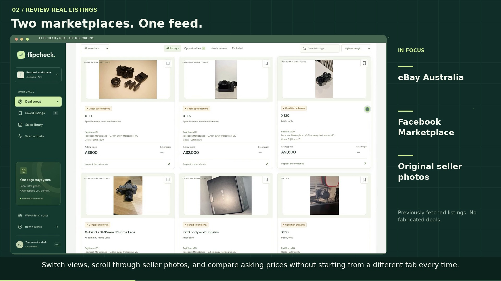

# FlipCheck video demo

[Download the MP4](https://raw.githubusercontent.com/quangvinhlee/FlipCheck/main/docs/demo/flipcheck-demo.mp4) · [English captions](flipcheck-demo.srt)

Approximately 1 minute 51 seconds, 1920×1080, 24 fps, H.264 video and AAC audio.
Includes Australian English synthetic narration, an original instrumental score,
burned captions and an embedded English subtitle track.

The film follows the repairer's sourcing problem through preparing product
searches, reviewing real eBay/Facebook listings, setting a pickup radius,
browsing seller photos, and checking local AI extraction against source text.
It explains the completed-sales evidence requirement, the local Gemma/Ollama
architecture, and the friend's early feedback and conditional willingness to pay.

No purchase, profit, payment, or measured time saving is claimed. Repair/parts
valuation is future work. Recordings use existing listings and do not trigger
new scans or save edits to the user's workspace. Search coordinates are blurred.

See [production sources and build instructions](../../scripts/demo/README.md).
The finished video can also be uploaded to a video host for embedding in DEV.
